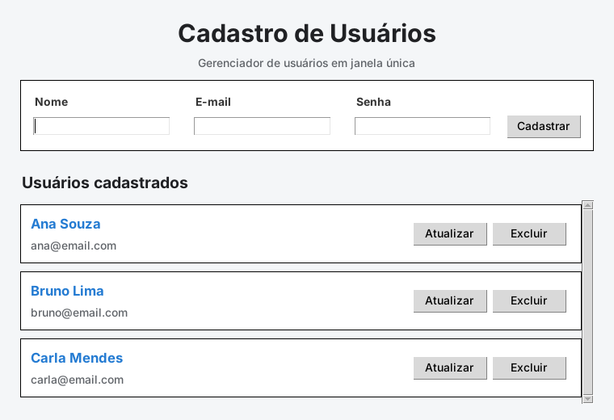

# 👤 Cadastro de Usuários (Tkinter + MySQL)

Aplicação desktop para gerenciar usuários, feita com **Python**, **Tkinter** e **MySQL**. A interface é uma janela única com formulário de cadastro e uma lista de cartões com rolagem, onde cada usuário pode ser atualizado ou excluído.



## Funcionalidades

- CRUD completo: cadastrar, listar, atualizar e excluir usuários
- Validação de campos, de formato de e-mail e de tamanho mínimo da senha
- E-mail único: o app avisa quando já existe um cadastro com o mesmo e-mail
- Senhas guardadas com **hash PBKDF2-SHA256 e salt aleatório** (nunca em texto puro)
- Consultas SQL parametrizadas, que evitam SQL Injection
- Confirmação antes de excluir
- Cria o banco e a tabela automaticamente na primeira execução
- Se o MySQL estiver fora do ar ou com credencial errada, mostra um aviso em vez de travar

## Tecnologias

Python 3 · Tkinter · MySQL · `mysql-connector-python` · `python-dotenv`

## Como rodar

**Pré-requisitos:** Python 3.10+ e um servidor MySQL (ou MariaDB) rodando.

```bash
# 1. Instale as dependências
pip install -r requirements.txt

# 2. Configure o acesso ao banco
cp .env.example .env        # no Windows: copy .env.example .env
# edite o .env com seu usuário e senha do MySQL

# 3. Execute
python app.py
```

O usuário do MySQL precisa de permissão para criar bancos (ou rode antes o `schema.sql`).

## Testes

```bash
python -m unittest discover -s tests -v
```

Os testes cobrem a geração e a verificação de hash de senha e não precisam de banco.

## Estrutura

```text
cadastro-usuarios-tkinter/
├── app.py           # ponto de entrada
├── interface.py     # janela, formulário, cartões e validações (Tkinter)
├── usuario.py       # classe Usuario com o CRUD
├── seguranca.py     # hash e verificação de senhas
├── conector.py      # conexão com o MySQL
├── banco.py         # criação do banco e da tabela
├── config.py        # leitura do .env
├── schema.sql       # script SQL opcional
├── tests/
└── docs/
```

